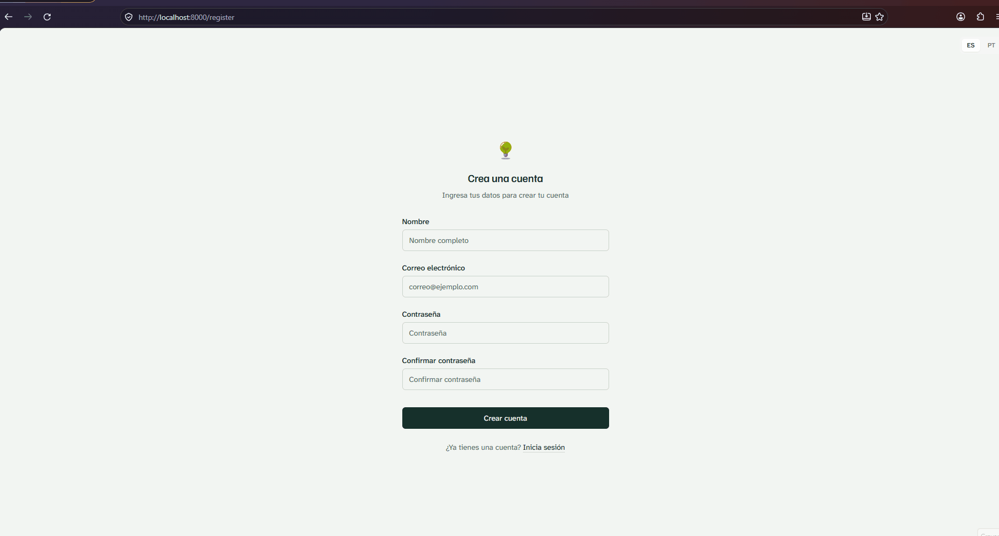

# SOSTENPYME: diagnóstico e plano de sustentabilidade para pymes




## Acesso

https://sostenpyme.onrender.com

> O serviço usa o plano gratuito do Render e "dorme" após alguns minutos sem acesso; o primeiro carregamento pode levar até um minuto.


## Desenvolvedores
- Aluno: Francisco das Chagas Sousa Júnior  
  Curso: Ciência da Computação

- Aluno: Lucas Medeiros Figueiredo dos Santos  
  Curso: Sistemas de Informação


## Proposta
Sistema de informação desenvolvido em colaboração com uma turma de Administração do Chile: o SOSTENPYME, uma ferramenta para que pequenas e médias empresas (pymes) façam um diagnóstico da própria sustentabilidade e planejem ações de melhoria. A partir de um protótipo inicial fornecido pela professora, os requisitos foram definidos com a equipe chilena (documentos "Preguntas para el Diagnóstico Inicial de Sostenibilidad" e "Cambios o mejoras en SOSTENPYME").

Funcionalidades:
- Cadastro, login e logout; cada usuário tem a sua empresa
- **Mi empresa**: perfil da empresa (setor, porte, número de trabalhadores, região)
- **Diagnóstico**: 20 perguntas em 4 dimensões (Ambiental, Social, Económica e Gobernanza), com respostas de 0 a 3, mais perguntas específicas do setor (ex.: Alimentos)
- **Resultado**: nota de 0 a 100 por dimensão, com Social dividida em Trabajadores e Comunidad, destaque das lacunas (nota abaixo de 50) e prioridades ordenadas da menor nota para a maior
- **Ruta sostenible**: metas por nível que a empresa marca como cumpridas
- **Mi plan**: ações escolhidas a partir das recomendações, com responsável, prazo, indicador e status
- **Seguimiento**: novo diagnóstico comparado com o anterior
- **Explorar ODS**: os 17 Objetivos de Desenvolvimento Sustentável explicados para uma pyme
- Interface em espanhol e português, com modo claro e escuro


## Desenvolvimento

### Processo

O primeiro passo foi definir quais tecnologias nós utilizaríamos, então foi discutido entre nós e nós também conversamos com a IA para saber a viabilidade de usá-las no nosso projeto. Definimos que usaríamos o Laravel para o backend e faríamos a autenticação e autorização usando Policies, o React, com TypeScript, via Inertia.js para o frontend. Tivemos que usar o PostgreSQL do Neon por conta da persistência dele ficar disponível, mesmo após o fim da disciplina, que era uma das exigências. Seria uma pasta apenas para o frontend e o backend, então só precisava hospedar em um lugar, que foi o Render utilizando Docker e Blueprint. 
Para iniciar o desenvolvimento, utilizamos os dois documentos que a Constanza e o Victor fizeram com sugestões de mudanças e as perguntas do diagnóstico. Fizemos a divisão da seguinte maneira: eu, Francisco, fiquei com a parte inicial do projeto de instalar as dependências, criar o projeto e fazer as páginas do frontend (as páginas de autenticação e de configurações já vieram prontas no starter kit do Laravel: /login (Entrar),/register (Cadastro),/forgot-password (Esqueci a senha),/reset-password (Redefinir a senha),/verify-email (Verificar o e-mail),/confirm-password (confirmar a senha), /settings/profile (Perfil), /settings/password (Alterar a senha), /settings/appearance (Aparência); eu fiz as páginas do usuário já autenticado: /dashboard (Início),/company (Minha empresa),/diagnosis (Diagnóstico),/results (Resultados),/path (Rota sustentável),/plan (Meu plano), /tracking (Acompanhamento), /explore (Explorar ODS)) de acordo com as especificações, mas usando somente o SQLite como armazenamento local só para o cadastro e login, as outras páginas estavam apenas como demonstrações, mas as informações não estavam sendo salvas no banco. Também implementei a opção de utilizar a aplicação em português ou espanhol. Em seguida, tivemos a reunião com a Constanza e o Victor no dia 16 para mostrar a eles como estava o site e eles acharam muito bom o resultado e que não tinham mais sugestões para mudanças. Então, subi no GitHub para o Lucas clonar o repositório e fazer a parte do backend e a criação do banco no Neon. Eu também fiquei responsável por fazer o deploy da ferramenta no Render. Tive dificuldades na hora de fazer o deploy, pois estava um erro de migration com o enderço -pooler do Neon, então tive que pedir ao Lucas para alterar essa configuração no nosso banco do PostgreSQL no Neon, alterar para a nova url do banco e após algumas tentativas deu certo.

**Conhecimentos prévios**
- **Francisco**: Eu não possuía conhecimento prévio nem em React e nem em Laravel, mas utilizei como tecnologias no projeto 2 e quis continuar para aprender um pouco mais sobre essas tecnologias em novos cenários e fazer uma aplicação mais completa que o projeto 2.
- **Lucas**:


### Trechos de código

**1. Cálculo das notas no servidor**: [`app/Services/DiagnosisScoring.php`](app/Services/DiagnosisScoring.php)

```php
foreach (self::AREAS as $area) {
    $scores[$area] = $percent($scored->where(in_array($area, ['workers', 'community']) ? 'group' : 'dimension', $area));
}
```

A nota não é enviada pelo navegador: ao salvar o diagnóstico, o backend recebe só as respostas (0 a 3) e recalcula tudo. A dimensão Social também é calculada em dois sub-resultados (Trabajadores e Comunidad), um pedido da equipe do Chile para que a lacuna em Comunidad não ficasse escondida pela média.

**2. Autorização com Policies**: [`app/Policies/PlanActionPolicy.php`](app/Policies/PlanActionPolicy.php) e [`app/Http/Controllers/SustainabilityController.php`](app/Http/Controllers/SustainabilityController.php)

```php
public function view(User $user, PlanAction $action): bool
{
    return $action->company->user_id === $user->id;
}
```

```php
public function updateAction(Request $request, PlanAction $action)
{
    Gate::authorize('update', $action);
```

Esconder botões no frontend não basta: se alguém enviar `PATCH /plan/5` com o id de uma ação de outra empresa, a Policy compara o dono da empresa com o usuário logado e responde 403. A empresa usada nas operações também é sempre obtida a partir do usuário autenticado, nunca de um id enviado pelo cliente.

**3. Tradução espanhol/português compartilhada entre frontend e backend**: [`resources/js/i18n/index.tsx`](resources/js/i18n/index.tsx) e [`app/Http/Middleware/SetLocale.php`](app/Http/Middleware/SetLocale.php)

```ts
// frontend: guarda o idioma escolhido num cookie
document.cookie = `${storageKey}=${locale};path=/;max-age=31536000;SameSite=Lax`;
```

```php
// backend: usa o mesmo cookie para as mensagens de validação do Laravel
App::setLocale($request->cookie('locale') === 'pt' ? 'pt_BR' : 'es');
```

Os textos da interface ficam em dicionários (`es.ts` e `pt.ts`) acessados por um hook `t('chave')`, e o TypeScript acusa erro se uma chave existir em um idioma e faltar no outro. Como o cookie é criado pelo JavaScript (sem criptografia), foi preciso excluí-lo da criptografia de cookies do Laravel em `bootstrap/app.php`.


## Tecnologias

### Linguagens e afins

- PHP 8.4 com [Laravel 12](https://laravel.com/) (starter kit React)
- TypeScript e [React 19](https://react.dev/)
- [Inertia.js](https://inertiajs.com/) (integração entre as rotas do Laravel e as páginas React, sem API REST separada)
- [Tailwind CSS 4](https://tailwindcss.com/) e componentes [shadcn/ui](https://ui.shadcn.com/) (Radix UI)
- [Vite](https://vite.dev/) (build do frontend)
- Ícones [Lucide](https://lucide.dev/); fontes [Familjen Grotesk](https://fonts.google.com/specimen/Familjen+Grotesk) e [Atkinson Hyperlegible Next](https://fonts.google.com/specimen/Atkinson+Hyperlegible+Next)
- Banco de dados: SQLite (desenvolvimento) e PostgreSQL 17 no [Neon](https://neon.tech/) (produção)
- Testes automatizados com PHPUnit (36 testes, incluindo autenticação, autorização e cálculo das notas)
- Deploy: Docker (PHP 8.4 + Apache) no [Render](https://render.com/)
- GitHub Actions para rodar os testes e o build a cada push

### Autenticação e autorização

**Autenticação por sessão**, usando a estrutura do starter kit do Laravel: no login, o Laravel cria uma sessão no servidor (armazenada no banco de dados) e envia ao navegador um cookie de sessão `httpOnly`, que acompanha cada requisição seguinte. Como frontend e backend estão no mesmo domínio (via Inertia), não foi necessário usar tokens. As senhas são guardadas com hash bcrypt, os formulários são protegidos contra CSRF e o cadastro cria automaticamente a empresa do usuário.

**Autorização no backend**:
- Todas as rotas do sistema ficam dentro do middleware `auth`; sem login, o usuário é redirecionado para a tela de entrada.
- A empresa é sempre obtida a partir do usuário logado (`$request->user()->company()`).
- *Policies* (`CompanyPolicy` e `PlanActionPolicy`) garantem que um usuário só veja e altere dados da própria empresa; tentativas de alterar dados de outra empresa retornam 403.
- Todas as gravações têm validação no servidor (por exemplo, respostas só de 0 a 3 e status só dos valores permitidos) e as notas do diagnóstico são recalculadas no backend.

### Ambiente de desenvolvimento
- Claude Code
- Chat GPT
- Git e GitHub 
- Render e Neon para deploy
- Visual Studio Code
## Referências e créditos

- Enunciado do projeto e protótipo inicial do SOSTENPYME, da professora Andrea Charão: https://github.com/elc1090/sostenpyme-prototype-2026b
- Equipe de Administração do Chile: documentos "Preguntas para el Diagnóstico Inicial de Sostenibilidad" (20 perguntas e regras de pontuação) e "Cambios o mejoras en SOSTENPYME"
- Referências enviadas pela equipe do Chile: [Tazki (software HSEQ)](https://soluciones.tazki.cl/software-hseq) e [Dcycle: mejores software de sostenibilidad](https://dcycle.io/es/blog/mejores-software-sostenibilidad/)
- Objetivos de Desenvolvimento Sustentável (ONU): https://brasil.un.org/pt-br/sdgs
- Documentação do Laravel (starter kits, autenticação, autorização com Policies, localização): https://laravel.com/docs
- Documentação do Inertia.js: https://inertiajs.com/
- Documentação do Neon sobre conexões com e sem pooling: https://neon.com/docs/connect/connection-pooling
- Documentação do Render (Blueprints e deploy com Docker): https://render.com/docs
- Claude Code 
- Chat GPT

---
Projeto entregue para a disciplina de [Desenvolvimento de Software para a Web](http://github.com/andreainfufsm/elc1090-2026b) em 2026b
