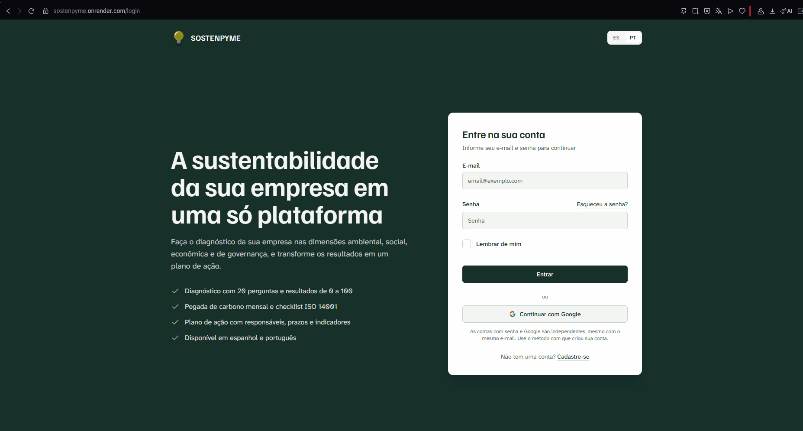

# SOSTENPYME: diagnóstico e plano de sustentabilidade para pymes




## Acesso

https://sostenpyme.onrender.com

> O serviço usa o plano gratuito do Render e "dorme" após alguns minutos sem acesso; o primeiro carregamento pode levar até um minuto.


## Desenvolvedores
- Aluno: Francisco das Chagas Sousa Júnior  
  Curso: Ciência da Computação

- Aluno: Lucas Medeiros Figueiredo dos Santos  
  Curso: Sistemas de Informação


## Proposta
Continuação do Projeto 3: o SOSTENPYME, sistema desenvolvido em colaboração com uma turma de Administração do Chile (Constanza e Victor) para que pequenas e médias empresas (pymes) façam um diagnóstico da própria sustentabilidade e planejem ações de melhoria.

No Projeto 3 entregamos a base: cadastro e login, perfil da empresa, diagnóstico com notas por dimensão, rota sustentável, plano de ações, acompanhamento e a página dos ODS. No projeto final, o sistema avançou a partir das novas reuniões com a equipe do Chile e das demandas da disciplina:

- **Pegada de carbono**: a empresa registra os consumos mensais (eletricidade, gás natural, GLP, diesel e gasolina) e o servidor calcula as emissões em kg CO₂e, com gráfico de rosca por fonte e colunas por mês
- **Checklist ISO 14001**: requisitos da norma de gestão ambiental que a empresa marca como cumpridos, com o percentual de aderência
- **Recomendações com IA**: na página de resultado, o Gemini gera de 3 a 5 ações personalizadas a partir das notas, das práticas fracas, da pegada de carbono e do plano da empresa, em espanhol ou português
- **Login com Google e perfil adicional** (curso/área, cidade, interesses e apresentação), mantendo também o login com e-mail e senha
- **Painel de administração** para a equipe do Chile: visão geral com médias por dimensão e empresas por setor, lista e detalhe (somente leitura) de todas as empresas e cadastro de usuários com senha provisória e definição de administradores
- **Nova tela de entrada** no estilo pedido pela equipe do Chile
- **Início com conteúdo informativo**: cards para passar de um tema a outro sobre ética e colaboração, triplo resultado (pessoas, planeta e lucro), benefícios sociais (incluindo a Lei Karin, Lei 21.643 do Chile), ambientais e econômicos e a sustentabilidade como valor agregado (governança/ESG)
- **Seguimiento** reúne agora o resumo do diagnóstico, da ISO 14001, da pegada de carbono, das prioridades e do plano, além da comparação entre diagnósticos

Funcionalidades que já existiam no Projeto 3:
- **Mi empresa**: perfil da empresa (setor, porte, número de trabalhadores, região)
- **Diagnóstico**: 20 perguntas em 4 dimensões (Ambiental, Social, Económica e Gobernanza), com respostas de 0 a 3, mais perguntas específicas do setor
- **Resultado**: nota de 0 a 100 por dimensão, com Social dividida em Trabajadores e Comunidad, destaque das lacunas e prioridades
- **Ruta sostenible**, **Mi plan** e **Explorar ODS**
- Interface em espanhol e português, com modo claro e escuro


## Desenvolvimento

### Processo

O processo desse último projeto foi mais tranquilo e colaborativo que os outros, tentamos ir fazendo aos poucos e ir incrementando ao passo que íamos fazendo as reuniões com a Constanza e o Victor e pegando o feedback que ele nos traziam. Quanto a parte do desenvolvimento em si, continuamos na divisão do Lucas fazer o backend e o Francisco o frontend. Mas no geral sempre nos comunicamos para decidir quem ficaria responsável por tais mudanças. O que ajudou muito foi o fato de continuarmos com o projeto 3 que já estávamos um pouco mais habituados às tecnologias e a como o estava sendo o fluxo do site. Tivemos algumas dificuldades de conseguir entender quais mudanças os nosso colegas chilenos queriam que fizéssemos, pois eles falavam de uma maneira um pouco aberta e nós precisávamos de algo mais prático. Mas, no fim das contas conseguimos nos entender e eles eram bem prestativos. 
Eu, Francisco, fiquei responsável pelas mudanças no frontend, que consistiam adicionar novos menus (Pegada de carbono e chcklist ISO 14001), gráficos, fazer alterações na tela de login. Foi algo tranquilo porque era mais do que já tinha feito antes, só o tipo de gráfico que mudou. Também mudei um pouco o fluxo dentro do site, por pedido dos chilenos, eles queriam que o início fosse algo mais informativo, com textos sobre questões de ética, meio ambiente e governança. Também fiz uma parte do processo de adicionar o login com o Google, que consistiu em pegar as informações do meu projeto no Google Cloud Console e colocá-las no Render, o Lucas fez uma parte e eu fiz a outra, porque o render estava na minha conta aí decidimos que eu já colocasse através do meu e-mail. Mas ele cuidou dessa parte do banco. Também fiquei responsável por colocar o diagnóstico de IA no site, utilizei o Google Gemini e não tive grandes dificuldades seguindo aquele tutorial da professora e pedindo ajuda ao Claude para adaptar para a nossa aplicação, visto que estávamos usando tecnologias diferentes do exemplo disponibilizado. Tive que adicionar uma tentativa automática para quando o Gemini desse falha na hora de gerar o diagnóstico e até agora está funcionando bem. Além disso, fiz o frontend do painel do admin que fizemos para os chilenos poderem ter um controle melhor do que os usuários estão fazendo e eles podem visualizar as empresas e usuários. No geral, tive uma experiência muito enriquecedora, aprendi coisas novas usando o Claude.


### Trechos de código

**1. Recomendações com IA: nova tentativa só quando faz sentido**: [`app/Services/GeminiClient.php`](app/Services/GeminiClient.php)

```php
for ($attempt = 1; ; $attempt++) {
    try {
        return $this->attempt($systemInstruction, $input, $schema);
    } catch (GeminiException $e) {
        if (! $e->retryable || $attempt >= 2) {
            throw $e;
        }
        Sleep::for(2)->seconds();
    }
}
```

No plano gratuito, o Gemini às vezes responde com erro de sobrecarga ou corta a resposta, e a mesma requisição funciona segundos depois. Por isso cada falha é marcada como "passageira" ou não: erros do servidor, de conexão e JSON inválido ganham uma nova tentativa; já o limite de uso (429) e erros da própria requisição (4xx) não, porque repetir só gastaria a cota. O pedido também usa um *schema* JSON, então a resposta já vem no formato que o frontend mostra (resumo e ações com área, título, descrição e primeiro passo), e o nome da empresa e o e-mail do usuário não são enviados ao Google.

**2. Admin pode ver, mas não alterar, os dados das empresas**: [`app/Policies/CompanyPolicy.php`](app/Policies/CompanyPolicy.php) e [`app/Http/Middleware/EnsureUserIsCompany.php`](app/Http/Middleware/EnsureUserIsCompany.php)

```php
public function view(User $user, Company $company): bool
{
    return $user->isAdmin() || $company->user_id === $user->id;
}

public function update(User $user, Company $company): bool
{
    return ! $user->isAdmin() && $company->user_id === $user->id;
}
```

```php
if ($request->user()?->isAdmin()) {
    abort_unless($request->isMethod('GET') || $request->isMethod('HEAD'), 403);

    return to_route('admin.dashboard');
}
```

A equipe do Chile pediu para acompanhar todas as empresas, sem mexer nos dados delas. A *Policy* separa os dois casos: o admin passa em `view`, mas nunca em `update`. Além disso, as rotas das empresas usam o middleware `company`: se um admin abre `/dashboard`, é levado para `/admin`; se tenta gravar algo, recebe 403. A página de detalhe do admin reaproveita os mesmos dados das páginas da empresa (`companyProps`), então os gráficos e componentes do frontend também foram reaproveitados.

**3. Login com Google e diferença de relógio**: [`app/Services/GoogleIdentity.php`](app/Services/GoogleIdentity.php)

```php
$previousLeeway = JWT::$leeway;
JWT::$leeway = 30;
try {
    $claims = $verifierClient->verify($idToken, ['audience' => config('services.google.client_id'), 'throwException' => true]);
} finally {
    JWT::$leeway = $previousLeeway;
}
```

O token do Google tem horário de emissão e de expiração. Se o relógio do servidor estiver alguns segundos atrás do relógio do Google, o token parece "emitido no futuro" e o login falha mesmo sendo válido. A tolerância de 30 segundos resolve isso, e o `finally` devolve o valor anterior para não afetar outras validações de JWT na aplicação.

**4. Pegada de carbono calculada no servidor**: [`app/Services/CarbonFootprint.php`](app/Services/CarbonFootprint.php)

```php
public const FACTORS = [
    'electricity_kwh' => 0.29,
    'natural_gas_m3' => 1.95,
    'lpg_kg' => 2.98,
    'diesel_l' => 2.68,
    'gasoline_l' => 2.31,
];
```

Assim como a nota do diagnóstico, as emissões não vêm do navegador: a empresa informa só os consumos do mês e o backend multiplica cada um pelo fator de emissão (kg CO₂e por unidade). Os fatores são referenciais (combustíveis com base no IPCC e eletricidade pelo fator médio do sistema elétrico do Chile) e servem para uma estimativa simples, não para um inventário oficial.


## Tecnologias

### Linguagens e afins

- PHP 8.4 com [Laravel 12](https://laravel.com/) (starter kit React)
- TypeScript e [React 19](https://react.dev/)
- [Inertia.js 2](https://inertiajs.com/) (integração entre as rotas do Laravel e as páginas React, sem API REST separada)
- [Tailwind CSS 4](https://tailwindcss.com/) e componentes [shadcn/ui](https://ui.shadcn.com/) (Radix UI)
- [Vite](https://vite.dev/) (build do frontend)
- Gráficos (rosca e colunas da pegada de carbono, barras de notas) feitos com SVG e CSS, sem biblioteca de gráficos
- Ícones [Lucide](https://lucide.dev/); fontes [Familjen Grotesk](https://fonts.google.com/specimen/Familjen+Grotesk) e [Atkinson Hyperlegible Next](https://fonts.google.com/specimen/Atkinson+Hyperlegible+Next)
- [Gemini API](https://ai.google.dev/gemini-api/docs) (plano gratuito, modelo `gemini-3.5-flash-lite`) para as recomendações com IA, chamada pelo cliente HTTP do Laravel
- Login com Google via OpenID Connect, com a biblioteca [google/auth](https://github.com/googleapis/google-auth-library-php) para validar o token
- Banco de dados: SQLite (desenvolvimento) e PostgreSQL 17 no [Neon](https://neon.tech/) (produção)
- Testes automatizados com PHPUnit (74 testes, incluindo autenticação, autorização, painel de admin, login com Google, recomendações com IA e cálculo das notas)
- Deploy: Docker (PHP 8.4 + Apache) no [Render](https://render.com/)
- GitHub Actions para rodar os testes, o lint e o build a cada push

### Autenticação e autorização

**Autenticação por sessão**, usando a estrutura do starter kit do Laravel: no login, o Laravel cria uma sessão no servidor (armazenada no banco de dados) e envia ao navegador um cookie de sessão `httpOnly`. Como frontend e backend estão no mesmo domínio (via Inertia), não foi necessário usar tokens. As senhas são guardadas com hash bcrypt e os formulários são protegidos contra CSRF. O usuário pode entrar com e-mail e senha ou com o Google; as duas contas ficam separadas, mesmo com o mesmo e-mail.

**Autorização no backend**:
- Há dois papéis: `company` (cada usuário com a sua empresa) e `admin` (equipe do Chile).
- As rotas das empresas usam os middlewares `auth` e `company`; as do painel usam `auth` e `admin` (403 para quem não é administrador).
- A empresa é sempre obtida a partir do usuário logado (`$request->user()->company()`).
- *Policies* (`CompanyPolicy` e `PlanActionPolicy`) garantem que um usuário só veja e altere dados da própria empresa; o admin só pode ver.
- O primeiro admin é criado por um *seeder* a partir das variáveis `ADMIN_EMAIL`, `ADMIN_NAME` e `ADMIN_PASSWORD` do Render. Os demais são cadastrados pelo painel, com senha provisória que deve ser trocada no primeiro acesso. Um admin não pode tirar o próprio papel, e o sistema sempre mantém pelo menos um administrador.
- Todas as gravações têm validação no servidor, e as notas e as emissões são recalculadas no backend. A geração de recomendações com IA é limitada a 5 por hora por usuário.

### Ambiente de desenvolvimento
- Visual Studio Code
- Claude Code
- ChatGPT
- Git e GitHub (GitHub Actions)
- PHP 8.4 e Node.js no Windows
- Render, Neon e Google AI Studio (chave da Gemini API) / Google Cloud Console (cliente OAuth)

## Referências e créditos

- Enunciado do projeto e protótipo inicial do SOSTENPYME, da professora Andrea Charão: https://github.com/elc1090/sostenpyme-prototype-2026b
- Demonstração de login com Google e perfil da disciplina: https://github.com/elc1090/demo-auth-profile
- Equipe de Administração do Chile (Constanza e Victor): documentos "Preguntas para el Diagnóstico Inicial de Sostenibilidad" e "Cambios o mejoras en SOSTENPYME", e o resumo da reunião de 03/11 com os pontos sobre ética, estratégia, benefícios e valor agregado
- Referências enviadas pela equipe do Chile: [Tazki (software HSEQ)](https://soluciones.tazki.cl/software-hseq) e [Dcycle: mejores software de sostenibilidad](https://dcycle.io/es/blog/mejores-software-sostenibilidad/)
- Objetivos de Desenvolvimento Sustentável (ONU): https://brasil.un.org/pt-br/sdgs
- Lei 21.643 (Lei Karin), Chile: https://www.bcn.cl/leychile/navegar?idNorma=1200096
- Lei 14.457/2022, Brasil: https://www.planalto.gov.br/ccivil_03/_ato2019-2022/2022/lei/l14457.htm
- ISO 14001 (sistemas de gestão ambiental): https://www.iso.org/standard/60857.html
- Diretrizes do IPCC para inventários de gases de efeito estufa (fatores de emissão): https://www.ipcc-nggip.iges.or.jp/public/2006gl/
- Documentação da Gemini API: https://ai.google.dev/gemini-api/docs
- Documentação do Google sobre OpenID Connect: https://developers.google.com/identity/openid-connect/openid-connect
- Documentação do Laravel (starter kits, autenticação, autorização com Policies, middlewares, seeders, localização): https://laravel.com/docs
- Documentação do Inertia.js: https://inertiajs.com/
- Documentação do Neon sobre conexões com e sem pooling: https://neon.com/docs/connect/connection-pooling
- Documentação do Render (Blueprints, variáveis de ambiente e deploy com Docker): https://render.com/docs
- Claude Code (Anthropic) e ChatGPT (OpenAI), usados como assistentes de programação

---
Projeto entregue para a disciplina de [Desenvolvimento de Software para a Web](http://github.com/andreainfufsm/elc1090-2026b) em 2026b
